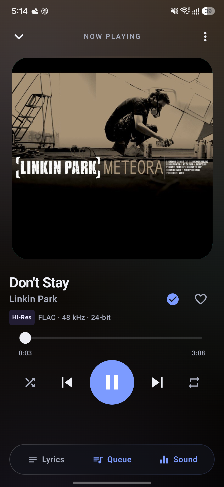
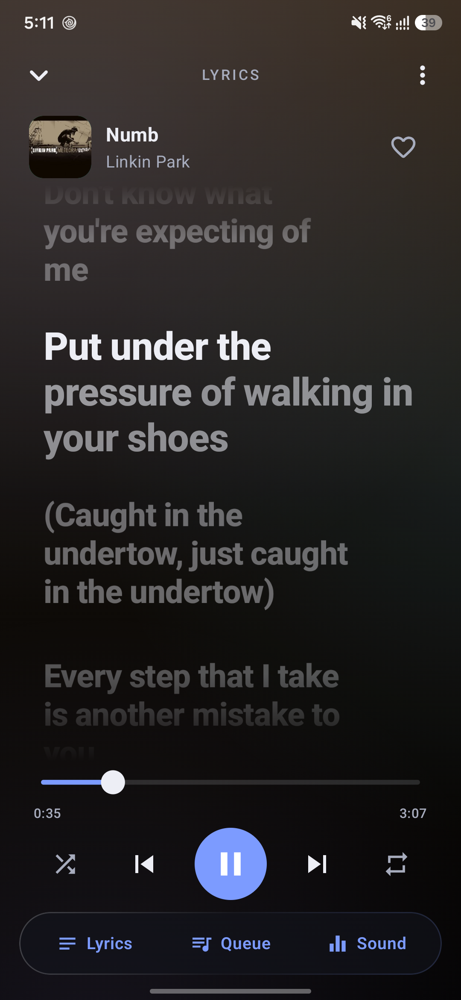
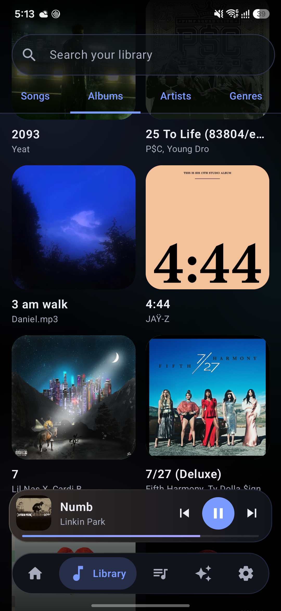
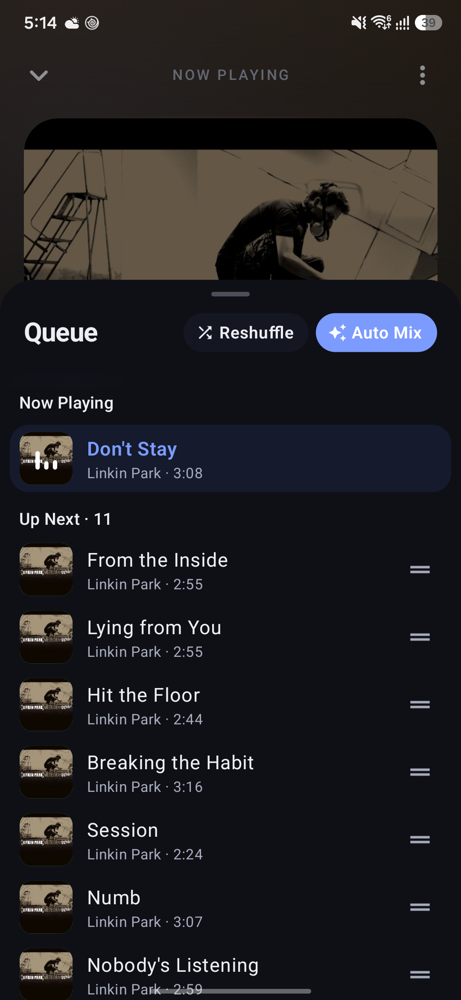
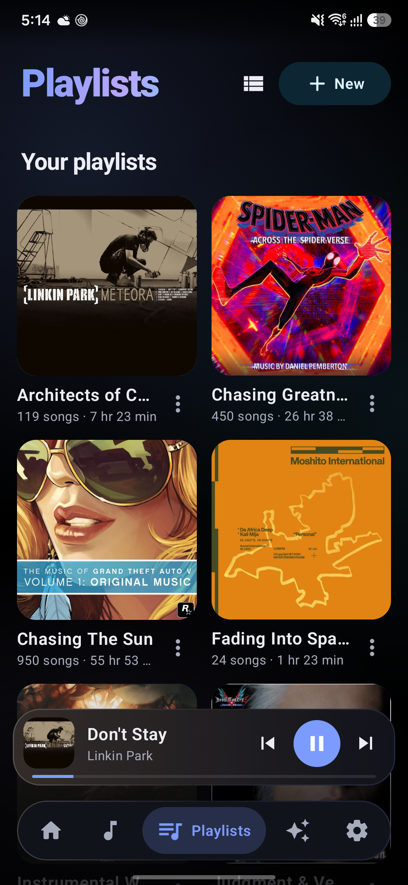
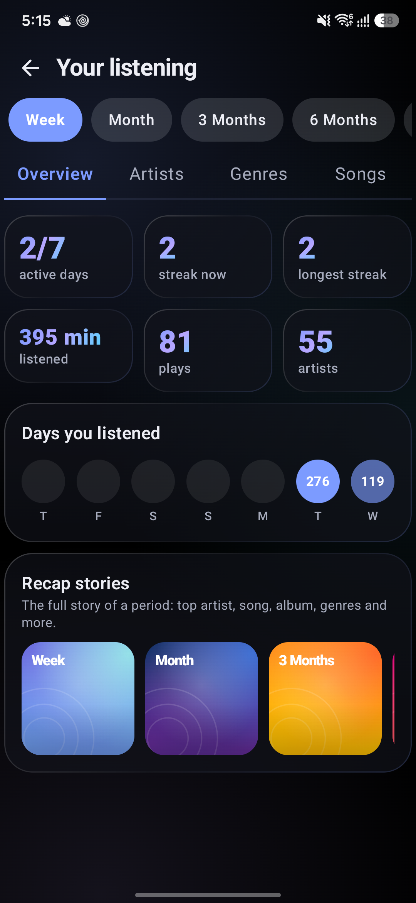
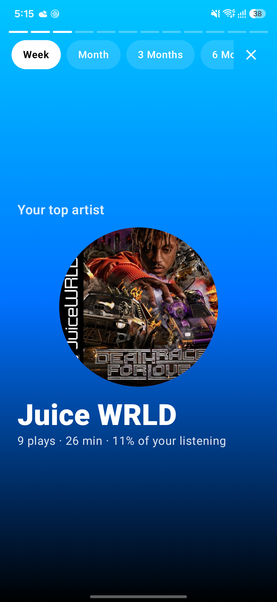
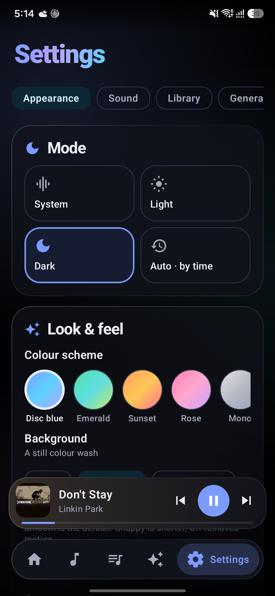

<div align="center">

# 💿 Pixel Disc

**Your music, beautifully played — offline, private and hi-res.**

[](https://github.com/reophyva/pixel-disc-releases/releases/latest)
[](#-requirements)
[](https://github.com/reophyva/pixel-disc-releases/releases)
[](PRIVACY.md)

</div>

Pixel Disc is an offline music player for Android that plays the music **you own** — the files
on your phone. No account, no streaming, no ads and no tracking. It's built for hi-res and
lossless libraries, with smooth crossfades, synced lyrics from your own files, smart mixes and
listening stats, all in a clean, modern design.

---

## ✨ Highlights

### 🎧 Playback & sound
- **Crossfade** between songs (0–12 s, equal-power) and **Auto Mix**, which orders your queue so neighbouring songs flow together.
- **Volume leveling** with ReplayGain (track or album), pre-amp, a level for untagged songs, and clipping protection.
- **Equalizer** with your device's bands and presets, plus bass boost, surround and loudness boost.
- **Trim silence** at the start and end of songs — never inside a song; live albums and DJ mixes are left alone.
- **Sleep timer**, and a notification with buttons you choose (shuffle, repeat or favourite).
- Works with the rest of Android: lock screen and notification controls, Bluetooth and headphone buttons, **resume after a restart**, Android Auto and Wear OS browsing, and **“Open with”** for audio files. Can be set as your default music app.

### 💎 Hi-res & lossless
- Plays FLAC, ALAC, WAV, AIFF, MP3, AAC/M4A, OGG and Opus (as supported by your device).
- Shows the real quality of every song — format, sample rate and bit depth — with **Hi-Res** and **Lossless** badges.
- Fast, precise seeking even in large FLAC files.

### 📚 Library
- Songs, Albums, Artists and Genres with search and sorting.
- Smart tag handling: several genres or artists in one tag, grouping of similar genre names, your own genres, and pinned genres and artists.
- Choose which folders to use, and hide short clips such as voice notes.

### 🎶 Queue
- Drag to reorder, swipe to remove (with undo), play history, and one-tap **Reshuffle**.

### 📀 Playlists & mixes
- Create playlists with a name, description and cover (your own image or a generated one); pin favourites; grid or list view.
- **Import and export** M3U and CSV playlists.
- **Premade mixes** made on your device from your library and listening: Daily Mix, mixes for the time of day and day of the week, After Dark, On Repeat, Rediscover, Forgotten Favorites, Favorites, Recently Added, Workout, Focus, Chill, Hi-Res Showcase, Time Machine, Short & Sweet and Long Plays — keep any of them with one tap.

### 🎤 Lyrics from your own files
- Synced, karaoke-style lyrics that light up word by word; tap a line to jump to it.
- Read only from your files: lyrics embedded in MP3, FLAC and M4A tags, a `.lrc` file next to the song, or a `.lrc` file you pick. Nothing is looked up online.

### 📊 Stats & recaps
- Listening streaks, a calendar of the days you listened, minutes and plays.
- Top artists, genres and songs for the last week, month, 3 months, 6 months or year.
- **Recap stories**: a full-screen story of your listening, including your top picks and your “listening personality” — then play your top songs or save them as a playlist.

### 🎨 Appearance
- Light, dark, follow the system, or **switch automatically by the time of day**.
- Five accent colours, three backgrounds, frosted-glass or solid cards, pure-black (AMOLED) mode, corner styles and animation levels.
- A layout made for tablets, and smooth on high-refresh-rate screens.

### 🤖 AI playlist maker (optional)
- Describe a mix — “chill evening, 1 hour” — and Pixel Disc builds it from your library, **on your device**.
- Optionally use Claude with **your own** Anthropic API key for smarter mixes. The key is stored **encrypted** on your phone and can be removed anytime. Turn AI off completely if you prefer.

### 🌐 Artist photos & bios (optional)
- A photo and short biography from Wikipedia, credited to their authors. Off by default.

### 💾 Backups
- Automatic backups (daily, weekly or monthly) to a folder you choose, plus manual backup and restore of playlists, favourites, play counts, listening history and settings.

### 🔄 Auto-updates
- Pixel Disc checks this page for new versions (at most once a day, can be turned off) and installs updates **only with your OK**, after verifying they're genuine.

---

## 📸 Screenshots

<table>
  <tr>
    <td align="center" width="33%"><br><b>Home</b></td>
    <td align="center" width="33%"><br><b>Now playing</b></td>
    <td align="center" width="33%"><br><b>Synced lyrics</b></td>
  </tr>
  <tr>
    <td align="center" width="33%"><br><b>Library</b></td>
    <td align="center" width="33%"><br><b>Queue</b></td>
    <td align="center" width="33%"><br><b>Playlists & mixes</b></td>
  </tr>
  <tr>
    <td align="center" width="33%"><br><b>Stats</b></td>
    <td align="center" width="33%"><br><b>Recap</b></td>
    <td align="center" width="33%"><br><b>Settings</b></td>
  </tr>
</table>

---

## 📋 Requirements

- **Android 10 or newer** (API level 29+)
- Music files stored on your device or SD card

## 📥 Install

1. Open the **[latest release](https://github.com/reophyva/pixel-disc-releases/releases/latest)** on your phone and download `PixelDisc-vX.Y.Z.apk`.
2. Open the downloaded file. If Android asks, allow **“Install unknown apps”** for your browser or file manager, then go back.
3. Tap **Install**, open Pixel Disc and follow the short setup.

### Updates
Pixel Disc checks for new versions automatically (at most once a day) and shows what's new.
Tap **Update now**, and the first time, allow **“Install unknown apps”** for Pixel Disc. Every
update is checked before installing: its SHA-256 checksum must match, and it must be signed by the
same developer certificate as the app you already have. You can also check manually, or turn the
automatic check off, in **Settings → About**.

## 🔐 Verify your download

Each release lists the SHA-256 checksum of the APK (also inside `version.json`). To check it:

- **Windows (PowerShell):** `Get-FileHash .\PixelDisc-vX.Y.Z.apk -Algorithm SHA256`
- **macOS / Linux:** `shasum -a 256 PixelDisc-vX.Y.Z.apk`

The result must match the checksum on the release page exactly.

### Signing certificate

The checksum proves the file matches the release page. The **signing certificate** proves the app
was made by the Pixel Disc developer, even if a download page were tampered with. Every official
Pixel Disc APK is signed with this certificate:

```
SHA-256: c5:5d:05:db:c0:04:71:c6:29:1f:10:98:61:99:5d:8b:d6:12:76:c1:2d:b1:62:8d:72:07:96:e9:1a:d2:b1:55
```

To check it, use `apksigner` from the Android SDK build-tools:

```
apksigner verify --print-certs PixelDisc-vX.Y.Z.apk
```

The line `Signer #1 certificate SHA-256 digest:` must show
`c55d05dbc00471c6291f109861995d8bd61276c12db1628d720796e91ad2b155`. If it shows anything else,
**don't install it**. The app's built-in updater checks this automatically, and Android itself
refuses to update Pixel Disc with an APK signed by a different certificate.

## 🛡️ Privacy

- **No ads, no analytics, no tracking, no account.** Your music, playlists and listening history stay on your device.
- Only optional features go online: Wikipedia for artist info (off by default), Anthropic only with your own API key, and the daily update check on GitHub (can be turned off).

Read the full **[Privacy Policy](PRIVACY.md)**.

## 💬 Support & feedback

Questions, bug reports or ideas: **[pixeldisc.support@gmail.com](mailto:pixeldisc.support@gmail.com)**

In the app, **Settings → General → Diagnostics** lets you copy or save a log to attach to your message.

## 🙏 Credits

- Created and developed by **ReOpHyVa**
- Built with the assistance of Claude Code by Anthropic
- Open-source components are listed in the app under **Settings → About → Open-source licenses**.

## 📄 License

Pixel Disc is **proprietary freeware**: free to download and use for personal use. Redistribution,
modification, reverse engineering or re-uploading require written permission. The source code is
not public. See **[LICENSE](LICENSE)**.

© 2026 ReOpHyVa. All rights reserved.
